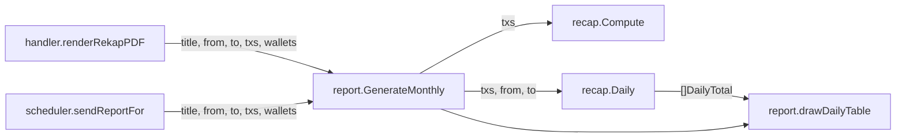

# Design — Daily Breakdown in PDF Report

## Overview
The PDF report gains a final table with one row per calendar day of the period (income, expense, difference) and a total row. The per-day aggregation is pure logic, so it goes in `internal/recap` next to `Compute`. Rendering goes in `internal/report`. The PDF generator currently receives only transactions, so it can't tell which days had nothing. Both callers (the `/rekap ... pdf` handler and the scheduler) already hold the period's `[from, to)`, and will now pass it in. The text `/rekap` reply and the existing PDF sections are left untouched.

## Architecture {#D-arch}

- Transactions come from `sheets.GetTransactionsInRange`, which already drops cancelled rows.
- `recap.Daily` is the only place that buckets by day. The table only renders what it returns.

## Components and Interfaces
### Daily aggregation {#D-daily}
_Satisfies: 1.2, 2.1, 2.2, 2.3, 2.4, 3.3_
- Responsibility: turn a period's transactions into exactly one total per calendar day.
- File: `internal/recap/recap.go`
- Interface:
```go
type DailyTotal struct {
    Date            time.Time // midnight local, start of the day
    Income, Expense float64
}
func (d DailyTotal) Net() float64 // Income - Expense
func Daily(txs []model.Transaction, from, to time.Time) []DailyTotal
```
- Behaviour:
  - Walks days from `from` to `to` (exclusive) with `AddDate(0, 0, 1)`, never by adding 24h, so it stays correct across DST. Result is in ascending date order (1.2).
  - Pre-fills one zero `DailyTotal` per day, so empty days and an empty period still produce every row (2.1, 2.2, 2.3).
  - Buckets each transaction by its `Date`'s year-month-day in `from.Location()`. `Date` is already local wall-clock, parsed with `ParseInLocation` (3.3).
  - Drops any transaction whose day falls outside `[from, to)`, so it never adds a row (2.4).
  - Counts only `model.Income` and `model.Expense`, the same switch as `Compute`.

### Indonesian date labels {#D-indo-labels}
_Satisfies: 5.1, 5.2_
- Responsibility: Indonesian day names and the short row date, plus the fixed Indonesian strings of the section.
- File: `internal/recap/recap.go` (helpers), `internal/report/report.go` (strings)
- Interface:
```go
func IndoWeekday(d time.Weekday) string // "Minggu" … "Sabtu"
func FormatDayShort(d time.Time) string  // "Senin, 3 Nov"
```
- Behaviour:
  - `FormatDayShort` = `IndoWeekday` + `", "` + day of month + `" "` + `IndoMonthAbbr`, with no year (5.2).
  - Section strings: heading "Rincian Harian", columns "Tanggal", "Pemasukan", "Pengeluaran", "Selisih", total label "Total" (5.1).
  - `internal/ai/intent.go` has a private copy of the weekday names. It stays as is: `ai` shouldn't import `recap` just for that.

### Daily table rendering {#D-daily-table}
_Satisfies: 1.3, 1.5, 3.1, 5.3, 5.4, 5.5_
- Responsibility: draw the `[]DailyTotal` as a four-column table with a total row.
- File: `internal/report/report.go`
- Interface:
```go
func drawDailyTable(pdf *gofpdf.Fpdf, tr func(string) string, w float64, days []recap.DailyTotal)
```
- Behaviour:
  - Total row = sum of the rows' Income and Expense, and their difference. Bold, like the wallet table's total row (1.3).
  - Before each row, if it would cross the bottom margin, calls `AddPage` and redraws the column header row. The heading plus header plus first row are kept together, so the heading is never stranded at a page bottom (1.5).
  - The total row's sums equal `stats.TotalIncome` / `stats.TotalExpense`, see Property 2 (3.1).
  - Every amount is drawn as `"Rp " + model.FormatAmount(x)` (5.3).
  - Difference cell: red `(180,30,30)` when negative, green `(20,130,20)` when positive, black when zero. Same RGB as `drawSummary` (5.4).
  - No row gets different fill, weight or colour other than the difference cell. Only the total row is bold (5.5).

### Report layout {#D-report-layout}
_Satisfies: 1.1, 1.4, 1.6, 4.5_
- Responsibility: put the section in the document, and keep everything else as it was.
- File: `internal/report/report.go`
- Interface:
```go
func GenerateMonthly(title string, from, to time.Time, txs []model.Transaction, wallets []model.Wallet) ([]byte, error)
```
- Behaviour:
  - After `drawWalletTable`, computes `days := recap.Daily(txs, from, to)`, and calls `drawDailyTable` only when `len(days) > 1`. So it is last, and absent for a single-day period (1.1, 1.4).
  - No chart is rendered for the daily data. `renderExpenseChart` stays the only chart (1.6).
  - The summary, pie chart, both category tables and the wallet table keep their existing order and code (4.5).
  - Auto page-break settings are unchanged, so the earlier sections behave exactly as before.

### Callers pass the period {#D-callers}
_Satisfies: 4.1, 4.2, 4.3, 4.4_
- Responsibility: give the generator the `[from, to)` each caller already has.
- File: `internal/handler/message.go`, `internal/scheduler/scheduler.go`
- Behaviour:
  - `renderRekapPDF` passes its `from, to` arguments. These are the same values `resolveRekap` produced for week, month, named-month and date periods (4.1).
  - `sendReportFor` passes its `from, to`, as computed by each `Schedule` (4.2).
  - `renderRekap` and `formatRecap` (the text path) are not modified (4.3, 4.4).

## Data Models {#D-data}
_Satisfies: 3.2, 3.4_
| Field | Source | Used by |
|---|---|---|
| `Transaction.Date` (local wall-clock) | `Transactions!B` via `parseTransactionRow` | `recap.Daily` day bucketing |
| `Transaction.Type` | `Transactions!C` | `recap.Daily`: Income/Expense counted, Transfer skipped (3.2) |
| `Transaction.Amount` | `Transactions!D` | daily sums |
| Cancelled mark | `Transactions!J` | `GetTransactionsInRange` already filters it out, so a `/batal`-ed row never reaches `Daily` (3.4) |
| `DailyTotal{Date, Income, Expense}` | `recap.Daily` | `drawDailyTable` |

There are no new spreadsheet columns, MySQL tables or config flags.

## Correctness Properties
### Property 1: one row per day, in order {#D-prop-1}
_Validates: 1.2, 2.1, 2.4_
*For any* `from` at local midnight, any `n ≥ 1`, `to = from.AddDate(0,0,n)` and any transactions, `Daily` returns exactly `n` entries. Entry `i` has `Date == from.AddDate(0,0,i)`, and every date lies in `[from, to)`.

### Property 2: daily totals equal the period totals {#D-prop-2}
_Validates: 3.1, 3.2_
*For any* transactions whose dates all lie in `[from, to)`, with integer-rupiah amounts, the sum of `Income` over `Daily(txs, from, to)` equals `Compute(txs).TotalIncome`. The same holds for `Expense` and `TotalExpense`. Transfers change neither side.

### Property 3: empty input gives all zeros {#D-prop-3}
_Validates: 2.2, 2.3_
*For any* period, `Daily(nil, from, to)` has every entry with `Income == 0`, `Expense == 0` and `Net() == 0`.

### Property 4: a transaction lands on its own local day {#D-prop-4}
_Validates: 3.3_
*For any* single income or expense dated at any wall-clock time on day `i` of the period, including `00:00:00` and `23:59:59`, only entry `i` is non-zero.

## Error Handling {#D-errors}
_Satisfies: 2.4_
- Transaction dated outside `[from, to)` (should not happen, since the fetch is ranged) → silently skipped, so no stray row appears (2.4). The total row then still equals the rows above it.
- `from >= to` (programming error) → `Daily` returns an empty slice, `len ≤ 1` hides the section, and the rest of the PDF renders normally.
- Fetch or render failures keep their existing messages ("❌ Gagal mengambil data transaksi.", "❌ Gagal membuat PDF: …") and the scheduler's retry. Nothing new is surfaced.

## Testing Strategy
| Criteria | Test type | File |
|---|---|---|
| 1.2, 2.1–2.4, 3.1–3.3 | Property tests (`testing/quick`) for Properties 1–4, plus table cases: month of 28/30/31 days, Mon–Sun week, a DST-zone month, transfer-only input | `internal/recap/recap_test.go` (new) |
| 5.2 | Table test of `FormatDayShort` / `IndoWeekday` for each weekday and month | `internal/recap/recap_test.go` |
| 1.1, 1.4, 1.5, 4.5 | `GenerateMonthly` smoke: single-day period vs 31-day period with no transactions both return a valid PDF (`%PDF` prefix). The 31-day one has a higher page count (`pdf.PageCount()`, via an unexported helper that returns the `Fpdf`) | `internal/report/report_test.go` (new) |
| 4.1, 4.2 | Compile-checked: both callers must pass `from, to` to the new signature | `go vet ./...` |
| 1.3, 1.6, 3.4, 4.3, 4.4, 5.1, 5.3–5.5 | Manual: generate one weekly and one monthly PDF with `/rekap ... pdf` and inspect it. 3.4 relies on the existing `GetTransactionsInRange` filter | n/a |

Rejected alternatives:
- Pass `recap.Stats` with a `Daily` field from callers: callers would duplicate the computation, and the generator already owns `Compute`.
- Infer the period from the earliest and latest transaction dates: it can't show leading or trailing empty days, and it breaks 2.1 and 2.3.
- Rename `GenerateMonthly` to `Generate`: it would be more accurate, but it's unrelated churn. Keep the name.
- Use gofpdf's `SetHeaderFunc` to repeat column headings: it would put the header on every page, not just the table's continuation pages.
