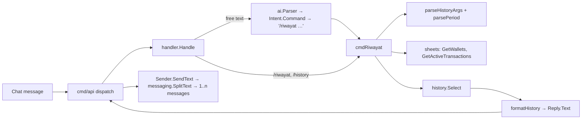

# Design — Transaction History

## Overview
Add `/riwayat` (alias `/history`) as one more case in `handleCommand`. It is a read-only command on the existing path: same lock, same housekeeping, same reply type. Choosing and ordering entries lives in a new dependency-free package, `internal/history`, so the rules can be tested without Sheets. Period words come from one parser extracted from `/rekap`, so both commands accept the same words. Long replies are split by the transports, which know each platform's limit; the handler still returns one `Reply`. Free-text history needs one new AI action that renders the same slash command.

## Architecture {#D-arch}

- Reads happen under the existing `lockSheet`, so the list and the undo target come from one consistent read.
- `history` imports only `model`. `handler` owns the parsing and Indonesian rendering.

## Components and Interfaces

### Command wiring {#D-cmd}
_Satisfies: 1.4, 5.3, 5.4, 5.6_
- Responsibility: route `/riwayat` and `/history` to `cmdRiwayat` and send the empty reply.
- File: `internal/handler/message.go`
- Interface: `func (h *MessageHandler) cmdRiwayat(ctx context.Context, sc *sheets.Client, args []string) string`
- Behaviour:
  - A new `case "/riwayat", "/history":` sits after the registration check, so unregistered chats get the existing `/daftar` instructions (1.4).
  - When `history.Select` returns `Total == 0`, it replies `📭 Belum ada transaksi[ untuk *DOMPET*][ pada LABEL_PERIODE].` (5.3).
  - With no filter, it adds `Catat dengan: /keluar 35rb GoPay Makanan Makan siang` (5.4).
  - It only calls read methods. `EnsureBalanceFormulas` and `withRecovery` run as for every command, which is decision D13 (5.6).

### Argument parsing {#D-args}
_Satisfies: 1.1, 2.1, 3.2, 3.5, 3.6_
- Responsibility: turn `args` into a query, or into a reply to send instead.
- File: `internal/handler/history_args.go` (new)
- Interface:
```go
type historyArgs struct {
    Count, Requested int          // Requested > Max_Count means the count was capped
    Period *period                // nil = no Period
    Wallet string                 // canonical name, "" = none
}
func parseHistoryArgs(now time.Time, wallets []model.Wallet, args []string) (historyArgs, string)
```
- Behaviour, in order:
  1. No args → `Count = 10` (1.1).
  2. The whole argument text equals a wallet name (case-insensitive) → that wallet only (3.5).
  3. Leading number: try `parsePeriod` from position 0 first, which handles `5 januari` (8.4). Otherwise read a whole number as the count, capped at 30 (2.1). `0`, `-3`, `2.5` and `1,5` get the Format_Reply.
  4. Then `parsePeriod` at the next position. Then `matchWalletPrefix` on what is left, so wallets with multi-word names and in any letter case work and the canonical name is shown (3.2).
  5. Text left after a matched wallet (`/riwayat BCA 5`, `/riwayat BCA mingguan`) gets the Format_Reply (3.6). If nothing matches as a wallet, the whole remainder is the attempted wallet name (see D-errors).
- Rejected: accepting arguments in any order, because the user chose a fixed order with no guessing (D8).

### Shared period parser {#D-period}
_Satisfies: 8.3, 8.4, 8.5_
- Responsibility: one grammar for `/rekap` and `/riwayat`. It reports how many words it used, so `/riwayat` can read a wallet name after the period.
- File: `internal/handler/period.go` (new). `resolveMonthRange`, `resolveWeekRange` and `resolveDayRange` move here from `message.go`.
- Interface:
```go
type period struct { From, To time.Time; Kind, Label string } // Kind: harian|mingguan|bulanan
func parsePeriod(now time.Time, tokens []string) (p *period, used int, errMsg string)
```
- Grammar: `bulan|bulanan [lalu | BULAN [TAHUN]]`, `minggu|mingguan [lalu | TGL [BULAN] [TAHUN]]`, `hari|harian [ini|lalu | TGL [BULAN] [TAHUN]]`, `kemarin`, plus their English aliases. Boundaries come from `recap.MonthRange`, `WeekRange` and `DayRange`.
- New bare forms: `TGL BULAN [TAHUN]` is that day (8.4), and `BULAN [TAHUN]` is that month.
- A number not followed by a month name is not a period (`used = 0`), so it falls through to the count (8.5).
- Text shaped like a date that is invalid (`31 feb`, `32 januari`, a year outside 2000–2100) returns `errMsg`, so the bot sends the Format_Reply. Validation checks the day against the days in that month (8.3).
- `cmdRekap` calls `parsePeriod` and ignores words left over, as it does today. Its titles become `"Rekap " + Kind + " — " + Label`, which is the same text as now.

### Selection and ordering {#D-select}
_Satisfies: 1.3, 2.4, 3.1, 4.2, 8.1_
- Responsibility: pick, group, filter, sort and limit entries. Pure logic.
- File: `internal/history/history.go` (new)
- Interface:
```go
type Query struct { Wallet string; From, To time.Time; HasPeriod bool; Limit int }
type Item struct { Tx model.Transaction; In *model.Transaction; Undo bool } // In set for a Transfer
type Result struct { Items []Item; Total int }                               // Total = matches before Limit
func Select(active []model.Transaction, q Query) Result                      // active is in Ledger order
```
- Behaviour:
  - The two sides of a Transfer are grouped by `RefID` into one Item. Its Ledger position is that of the later side, and it counts once toward `Limit` (4.2).
  - The wallet filter matches `Tx.Wallet` or `In.Wallet` (3.1). The period filter keeps `From <= Date < To` (8.1).
  - Sorting is by `Date` (Recorded_Time, to the second), newest first, then by Ledger position, later first (1.3).
  - `Items` is cut to `Limit`, and a shorter result is simply returned (2.4).

### Undo target {#D-undo}
_Satisfies: 6.1, 6.2, 6.3_
- File: `internal/history/history.go`
- Behaviour:
  - The target is the last element of `active`, which is the Ledger order, the same row `sheets.lastActive` picks for `/batal` (6.1).
  - If the target has a `RefID`, the whole Transfer Item is marked (6.3).
  - `Undo` is set only on an Item that survives the filters and the limit, so a filtered list may have no mark (6.2).

### Entry rendering {#D-render}
_Satisfies: 1.2, 1.5, 4.1, 4.3, 7.1_
- File: `internal/handler/history_format.go` (new). The pure `history.FormatEntryDate(t, now time.Time) string` is in `internal/history/history.go`.
- Each Item is one paragraph with no blank line inside it, which lets the splitter keep it whole:
```
🔴 *3 Jan 14:05* · Pengeluaran Rp 35.000
💳 GoPay · 🏷️ Makanan
📝 Makan siang
```
- Income uses 💚 Pemasukan and expense uses 🔴 Pengeluaran (1.2). A Transfer shows `🔄 … Transfer Rp X` and then `💸 BCA → GoPay` (4.1).
- When filtered by a wallet, a Transfer line reads `⬅️ Masuk ke GoPay` or `➡️ Keluar dari BCA` (4.3).
- The full description is shown. Newlines inside it are shown as spaces so the entry stays one paragraph (1.5).
- An Item marked as the undo target gets the extra line `↩️ _Ini yang dibatalkan oleh /batal_`.
- Amounts use `model.FormatAmount`, and the markup is the `*bold*`/`_italic_` already used in other replies (7.1).

### List header and footer {#D-frame}
_Satisfies: 2.2, 2.5, 3.4, 8.2_
- File: `internal/handler/history_format.go`
- Header: `📜 *Riwayat Transaksi*`, then ` — DOMPET` when filtered (3.4), then ` — LABEL_PERIODE` with dates, e.g. `Mingguan 3–9 Nov 2026` (8.2).
- When `Total > len(Items)`, the footer says `…dan N transaksi lainnya.` (2.5).
- When the requested count was above 30, it adds `_Maksimal 30 transaksi per permintaan._` (2.2).

### Message splitting {#D-split}
_Satisfies: 7.5_
- Responsibility: keep every text reply within each platform's limit, without cutting an entry in half.
- File: `internal/messaging/split.go` (new). It is called from `SendText` in `internal/telegram/telegram.go` (limit 4000, before `ToHTML`), `internal/whatsappcloud/client.go` (limit 4000) and `internal/wasend/wasend.go` (limit 60000).
- Interface: `func SplitText(text string, limit int) []string`, where the limit counts UTF-16 code units (how Telegram counts; an emoji outside the BMP is two).
- Behaviour:
  - It packs whole paragraphs (split on `\n\n`) into chunks. A paragraph longer than the limit on its own falls back to line breaks, then to rune boundaries (never inside an emoji). That is the only case where an entry is split (D10).
  - Chunks are sent in order, and sending stops at the first error.
- Rejected: returning several texts in `Reply` from the handler. That puts platform limits into the handler, which must stay platform-agnostic.

### Help text {#D-help}
_Satisfies: 7.2_
- File: `internal/handler/message.go`, `helpMessage()`
- Adds a `📜 *Riwayat:*` block: `/riwayat [jumlah] [periode] [dompet]` (alias `/history`) with the example `_Contoh: /riwayat 20 mingguan GoPay_`. The Format_Reply reuses this block.

### Free-text history {#D-ai}
_Satisfies: 7.3, 7.4_
- Files: `internal/ai/intent.go`, `internal/ai/command.go`
- Changes:
  - A new `ActionHistory = "history"`.
  - New schema fields: `count` (integer, 0 = not stated) and `wallet_text`. `wallet_text` is the wallet the user typed, exactly as written, when it is not on the list.
  - The system prompt gets one line describing history.
- `Command()` renders `/riwayat [count] [period words] [wallet]` and always returns `ok`. `Mutates()` stays false.
- The period mapping is separate from `recapArgs`, because "this month" must render as `bulanan`, not as an empty string (7.3).
- When `Wallet` is "none" but `wallet_text` is set, the command carries `wallet_text`. The command path then sends the Wallet_Not_Found_Reply, instead of the model's "none" quietly widening to the whole list (7.4).

## Data Models {#D-data}
_Satisfies: 5.1, 5.2_
| Field | Source | Used by |
|---|---|---|
| Date (Recorded_Time) | `Transactions!B`, parsed with `time.ParseInLocation` | sorting, period filter, Entry_Date |
| Type, Amount, Wallet, Category, Description | `Transactions!C–G` | rendering, wallet filter |
| RefID, Direction | `Transactions!H–I` | grouping a Transfer, from/to, in/out |
| Cancelled | `Transactions!J` | left out by the new read |
- New `func (c *Client) GetActiveTransactions(ctx context.Context) ([]model.Transaction, error)` in `internal/sheets/client.go`. It reads through `readTransactions` and `withRecovery`, drops cancelled rows (5.1) and keeps Ledger order.
- Rows from every chat that shares the sheet are already in the same tab (5.2).

## Correctness Properties

### Property 1: The list is ordered and bounded {#D-prop-1}
_Validates: 1.3, 2.1, 2.4_
*For any* active list and query, `len(Items) <= Limit`, `Total >= len(Items)`, and the Items are in non-increasing (Date, Ledger position) order.

### Property 2: A Transfer appears exactly once {#D-prop-2}
_Validates: 4.2_
*For any* active list, no `RefID` appears in more than one Item, and both sides of a Transfer share one Item.

### Property 3: Filters admit only matches {#D-prop-3}
_Validates: 3.1, 8.1_
*For any* query with a Wallet and/or a period, every Item involves that Wallet and has a Date in `[From, To)`. With `Limit` at least the number of matches, every matching transaction is represented.

### Property 4: The undo mark is truthful {#D-prop-4}
_Validates: 6.1, 6.2, 6.3_
*For any* active list and query, at most one Item has `Undo`, and an Item with `Undo` contains the last element of `active`.

### Property 5: Splitting loses nothing and respects the limit {#D-prop-5}
_Validates: 7.5_
*For any* text and limit, every chunk is at most the limit. Joining the chunks gives back the text, apart from the separators at the cuts. A paragraph is split only when it alone exceeds the limit.

### Property 6: A whole wallet name wins {#D-prop-6}
_Validates: 3.5_
*For any* wallet whose name, case-folded, equals the whole argument text, `parseHistoryArgs` returns that wallet with no count and no period.

## Error Handling {#D-errors}
_Satisfies: 2.3, 3.3, 5.5_
- An invalid count (`0`, negative, decimal) → the Format_Reply: `❌ Format: …` followed by the help block (2.3).
- An unknown wallet → the existing `walletNotFoundMsg(wallets, remainder)` (3.3).
- A failed `GetWallets` or `GetActiveTransactions` → `❌ Gagal memuat riwayat transaksi. Coba lagi sebentar.` The error goes to `log.Printf` and nothing is written (5.5).
- An invalid date → the Format_Reply (from D-period).
- An error while sending one chunk → it is logged in `dispatch` as today, and the remaining chunks are not sent.

## Testing Strategy
| Criteria | Test type | File |
|---|---|---|
| 1.3, 2.4, 3.1, 4.2, 6.1–6.3, 8.1 | table tests and properties 1–4 | `internal/history/history_test.go` |
| 1.2, 1.5, 2.2, 2.5, 3.4, 4.1, 4.3, 5.3, 5.4, 7.1, 8.2 | golden-string tests of `formatHistory` | `internal/handler/history_format_test.go` |
| 1.1, 2.1, 2.3, 3.2, 3.3, 3.5, 3.6, 8.3–8.5 | table tests of `parseHistoryArgs` and `parsePeriod`, plus property 6 | `internal/handler/history_args_test.go`, `internal/handler/period_test.go` |
| `/rekap` unchanged | table tests of titles and ranges before and after the extraction | `internal/handler/period_test.go` |
| 7.5 | property 5 and edge cases (one oversized paragraph, exactly the limit) | `internal/messaging/split_test.go` |
| 7.3, 7.4 | `Command()` table tests for `ActionHistory` | `internal/ai/command_test.go` |
| 5.1, 5.2 | the cancelled-row case in the live suite | `internal/sheets/live_test.go` (`-tags live`) |
| 1.4, 5.5, 5.6, 7.2 | review only (no Sheets fake exists) | — |

## Open questions
1. With the shared parser, `/rekap harian 31 februari` would reply with format help instead of silently showing 3 March. Recommended: accept this; it is a bug fix.
2. Free-text history supports only the six relative periods the AI already knows (today, yesterday, this or last week, this or last month). Named months still need the slash command. Recommended: accept for now; extending the schema to dates is a separate change.
3. Bare `BULAN [TAHUN]` (e.g. `/riwayat januari`) is accepted as that month, alongside the bare date R8.4 requires. Without it, `januari` would get the Format_Reply. Recommended: accept.
